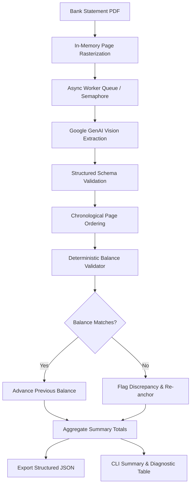

# Multimodal Bank Statement Parser & Mathematical Balance Validator

An asynchronous multimodal extraction pipeline and deterministic mathematical verification engine for flattened, scanned, or vector-rasterized bank statements.

Built with **Google GenAI**, **Pydantic v2**, and **pdfplumber**, this library extracts tabular financial transactions from image-only PDFs with zero native text characters, enforces strict structured schemas, and performs exact `Decimal` balance auditing with automatic discrepancy re-anchoring.

---

## Features

- **Multimodal Page-by-Page Extraction**: Rasterizes flattened PDFs into in-memory page images and extracts transactions page-by-page using Google GenAI vision models, avoiding output token truncation on long statements and allowing granular page-level retry recovery.
- **Controlled Async Concurrency**: Uses an `asyncio.Semaphore` worker pool (configurable concurrency) with automated exponential backoff on HTTP 429 rate limits and transient server errors.
- **Strict Schema Enforcement**: Extracts typed data (date, narration, cheque/reference number, withdrawal, deposit, and running balance) directly into Pydantic models without manual or fragile JSON parsing.
- **Narration Merging**: Automatically consolidates wrapped, multi-line transaction particulars, remarks, and reference lines into a single coherent narration string.
- **Header & Footer Filtering**: Automatically skips recurring table headers, metadata footers, and carry-forward balances (such as "Brought Forward" or "Balance B/F") to isolate actual financial movements.
- **Deterministic Balance Validation**: Mathematically audits every consecutive transaction using the accounting formula:
  $$\text{Expected Balance} = \text{Previous Balance} - \text{Withdrawal} + \text{Deposit} = \text{Running Balance}$$
- **Discrepancy Re-anchoring**: If a mismatch occurs (e.g. from an unlisted bank fee or an optical artifact), the system flags the transaction with the exact variance delta and re-anchors to the stated balance, preventing cascading false-positive errors across subsequent transactions.
- **Exact Decimal Arithmetic**: Performs all calculations using Python's `decimal.Decimal` to eliminate floating-point rounding errors.
- **Dual Reporting**: Exports comprehensive structured JSON files with aggregate totals and provides clean, formatted CLI summary tables with discrepancy diagnostics.

---

## Core Concepts

| Concept | Meaning |
| :--- | :--- |
| **Transaction** | An individual debit or credit entry on a bank statement reflecting account activity. |
| **Narration** | The textual description or particulars detailing the purpose and parties of a transaction. |
| **Running Balance** | The stated account balance after the application of a transaction. |
| **Discrepancy** | A mathematical mismatch where $\text{previous\_balance} - \text{withdrawal} + \text{deposit} \neq \text{stated running balance}$. |
| **Re-anchoring** | Resetting the expected balance to the stated running balance following a discrepancy to prevent false cascading failures. |
| **Baseline Balance** | The initial stated running balance from which sequential mathematical verification commences. |

---

## Architecture & Workflow



---

## Installation

### Prerequisites

- **Python**: `>=3.14`
- **Google GenAI API Key**: An API key from [Google AI Studio](https://aistudio.google.com/).

### Setup

Clone the repository and install the dependencies:

```bash
git clone https://github.com/shAriqsh/parse-bank-statement.git
cd parse-bank-statement

# Using uv (recommended)
uv sync

# Or using pip
python -m venv .venv
source .venv/bin/activate  # On Windows: .venv\Scripts\activate
pip install -e .
```

### Configuration

Create a `.env` file in the root directory:

```env
GEMINI_API_KEY=your_gemini_api_key_here

# Optional: override default model (e.g., gemini-2.0-flash, gemini-2.5-flash-lite)
GEMINI_MODEL=gemini-2.0-flash
```

---

## Usage

### Command-Line Interface (CLI)

Run the parser on any PDF statement:

```bash
uv run python main.py path/to/statement.pdf
```

#### CLI Options

```bash
uv run python main.py [pdf_path] [-o OUTPUT] [-c CONCURRENCY]
```

| Argument | Description | Default |
| :--- | :--- | :--- |
| `pdf_path` | Path to the bank statement PDF file | `account.pdf` |
| `-o, --output` | Target path for the structured JSON export | `transactions.json` |
| `-c, --concurrency` | Maximum concurrent page extraction workers | `5` |


---


## Project Structure

```
parse-bank-statement/
├── main.py                    # CLI entrypoint wrapper
├── pyproject.toml             # Project dependencies and configuration
├── src/
│   └── bank_statement/
│       ├── __init__.py        # Package exports
│       ├── cli.py             # CLI parser and command handler
│       ├── config.py          # Environment settings & client factory
│       ├── extractor.py       # PDF rasterization & multimodal vision extraction
│       ├── models.py          # Pydantic domain models
│       ├── orchestrator.py    # Asynchronous pipeline coordinator
│       ├── reporter.py        # JSON exporter and CLI diagnostic formatter
│       └── validator.py       # Decimal mathematical balance validator
└── tests/
    ├── test_balance_validator.py
    ├── test_cli.py
    ├── test_config.py
    ├── test_extraction_models.py
    ├── test_extractor.py
    ├── test_orchestrator.py
    └── test_reporter.py
```

---

## Testing & Type Checking

Run the test suite:

```bash
uv run pytest
```

Run static type checking:

```bash
uv run mypy src tests
```

---

## License

This project is licensed under the MIT License.
