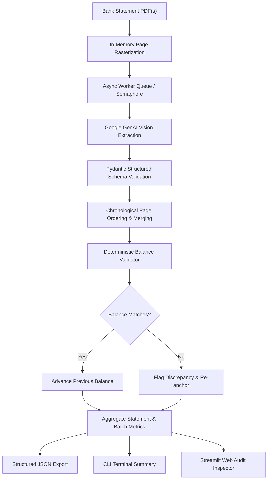

# Multimodal Bank Statement Parser & Mathematical Balance Validator

An asynchronous multimodal extraction pipeline and deterministic mathematical verification engine for flattened, scanned, and vector-rasterized bank statements.

Built with **Google GenAI**, **Pydantic v2**, **pdfplumber**, and **Streamlit**, this project extracts tabular financial transactions from image-only PDFs with zero native text characters, enforces strict structured schemas, performs exact `Decimal` balance auditing with automatic discrepancy re-anchoring, and provides both CLI and interactive Web UI interfaces.

---

## Features

- **Multimodal Page-by-Page Extraction**: Rasterizes PDF pages into in-memory images and extracts tabular transactions using Google GenAI vision models (`gemini-2.0-flash`), eliminating output token truncation on long statements and allowing page-level retry recovery.
- **Controlled Async Concurrency**: Uses an `asyncio.Semaphore` worker pool with configurable concurrency and automated exponential backoff on HTTP 429 rate limits or transient network errors.
- **Strict Schema Enforcement**: Validates typed transaction fields (date, narration, cheque/reference number, withdrawal, deposit, running balance) directly into Pydantic v2 models.
- **Intelligent Narration Merging**: Automatically consolidates wrapped, multi-line particulars, transaction remarks, and reference lines into a single coherent narration string.
- **Header & Footer Filtering**: Automatically detects and skips recurring table headers, metadata footers, and carry-forward balances (e.g., "Brought Forward" or "Balance B/F") to isolate genuine financial activity.
- **Deterministic Balance Validation**: Mathematically audits every consecutive transaction using the accounting equation:
  $$\text{Expected Balance} = \text{Previous Balance} - \text{Withdrawal} + \text{Deposit} = \text{Running Balance}$$
- **Discrepancy Re-anchoring**: When a mathematical mismatch occurs (e.g., an unlisted bank fee or an optical artifact), the transaction is flagged with the exact variance delta and re-anchors to the stated balance, preventing cascading false-positive errors.
- **Exact Decimal Arithmetic**: Implements all financial calculations using Python's `decimal.Decimal` to avoid floating-point rounding errors.
- **Batch Multi-Statement Processing**: Supports passing multiple PDF files or entire directories. Generates aggregate batch summaries, unified JSON outputs, and optional per-statement JSON files.
- **Interactive Web UI (Streamlit)**: Includes a browser-based audit inspector featuring drag-and-drop multi-file upload, live processing progress, KPI summary banners, isolated tabbed statement views, discrepancy highlight badges, and JSON export downloads.
- **Comprehensive Dual Reporting**: Exports structured JSON files with aggregate metrics and renders terminal summary tables with clear discrepancy diagnostics and exit codes.

---

## Core Concepts

| Concept | Meaning |
| :--- | :--- |
| **Transaction** | An individual debit or credit entry on a bank statement reflecting financial account activity. |
| **Narration** | The textual description detailing the transaction's purpose, merchant, and reference details. |
| **Running Balance** | The stated balance on the bank statement after the application of a transaction. |
| **Discrepancy** | A mathematical mismatch where $\text{previous\_balance} - \text{withdrawal} + \text{deposit} \neq \text{stated running balance}$. |
| **Re-anchoring** | Resetting the expected balance to the stated running balance after a discrepancy to prevent false cascading failures. |
| **Baseline Balance** | The initial stated running balance from which sequential mathematical verification begins. |
| **Batch Processing** | Processing multiple bank statements concurrently or sequentially, aggregating statistics across statements. |

---

## Architecture & Workflow



---

## Installation

### Prerequisites

- **Python**: `>=3.14`
- **Google GenAI API Key**: Obtain an API key from [Google AI Studio](https://aistudio.google.com/).

### Setup

Clone the repository and install dependencies:

```bash
git clone https://github.com/shAriqsh/parse-bank-statement.git
cd parse-bank-statement

# Using uv (recommended)
uv sync

# Or using pip / venv
python -m venv .venv
# Linux / macOS:
source .venv/bin/activate
# Windows:
.venv\Scripts\activate

pip install -e .
```

### Configuration

Create a `.env` file in the project root:

```env
GEMINI_API_KEY=your_gemini_api_key_here

# Optional: configure model name (defaults to gemini-2.0-flash)
GEMINI_MODEL=gemini-2.0-flash
```

---

## Usage

### 1. Command-Line Interface (CLI)

#### Single Statement

Parse a single PDF statement and export the result:

```bash
uv run python main.py statement.pdf -o transactions.json
```

#### Multiple Statements & Directories

Process multiple PDF files or an entire folder of statements in batch mode:

```bash
# Multiple specific files
uv run python main.py statement1.pdf statement2.pdf -o batch_summary.json

# Entire folder of statements with individual per-statement exports
uv run python main.py ./statements/ -o batch_summary.json --output-dir ./exports/
```

#### CLI Options

```bash
uv run python main.py [pdf_paths ...] [options]
```

| Argument | Description | Default |
| :--- | :--- | :--- |
| `pdf_paths` | One or more PDF paths or directory paths containing PDF statements | `account.pdf` |
| `-o, --output` | Output path for the aggregated structured JSON file | `transactions.json` |
| `--output-dir` | Optional directory to save per-statement JSON exports (`<stem>_transactions.json`) | `None` |
| `-c, --concurrency` | Maximum concurrent page extraction workers per statement | `5` |

---

### 2. Interactive Web Audit Inspector (Streamlit UI)

Launch the interactive web UI:

```bash
# Using the CLI subcommand
uv run python main.py ui

# Specifying custom port and host
uv run python main.py ui --port 8501 --host localhost

# Or directly with Streamlit
uv run streamlit run src/bank_statement/ui/app.py
```

#### Web UI Highlights:
- **Multi-File PDF Upload**: Drag and drop single or multiple statements simultaneously.
- **Live Progress Tracking**: Visual phase indicator showing rasterization, async extraction, and balance validation.
- **Batch KPI Summary**: Overview metric cards for total statements, valid vs. discrepant statements, transaction counts, total withdrawals, and total deposits.
- **Statement Tabs**: Isolated tabs for each statement with status badges (`✅ VALID` / `⚠️ DISCREPANCY DETECTED`).
- **Interactive Data Table**: View all parsed transactions with explicit color-coded visual alerts for any balance discrepancies.
- **JSON Download**: Direct one-click download of parsed structured results.

---

## Project Structure

```
parse-bank-statement/
├── main.py                         # CLI entrypoint and UI launcher
├── pyproject.toml                  # Dependencies and build configuration
├── src/
│   └── bank_statement/
│       ├── __init__.py             # Public package exports
│       ├── cli.py                  # CLI argument parser and command handlers
│       ├── config.py               # Environment configuration and GenAI client factory
│       ├── extractor.py            # PDF rasterization & multimodal vision extraction
│       ├── models.py               # Pydantic domain models (Transaction, Statement, Batch)
│       ├── orchestrator.py         # Asynchronous extraction coordinator
│       ├── reporter.py             # JSON exporter and CLI summary table formatter
│       ├── validator.py            # Decimal sequential balance validator
│       └── ui/
│           ├── __init__.py         # UI module init
│           ├── app.py              # Streamlit application entrypoint
│           ├── components.py       # Reusable Streamlit UI widgets and tables
│           └── runner.py           # Streamlit subprocess launcher
└── tests/
    ├── test_balance_validator.py   # Tests for balance math and discrepancy re-anchoring
    ├── test_batch_models.py        # Tests for multi-statement data structures
    ├── test_cli.py                 # Tests for CLI flags, path resolution, and exit codes
    ├── test_config.py              # Tests for environment and API key handling
    ├── test_extraction_models.py   # Tests for Pydantic transaction models
    ├── test_extractor.py           # Tests for PDF rasterization and retry mechanics
    ├── test_orchestrator.py        # Tests for async extraction flow
    ├── test_reporter.py            # Tests for JSON output and CLI table formatting
    └── test_ui.py                  # Tests for Streamlit UI components and layout
```

---

## Testing & Verification

Run the automated test suite:

```bash
uv run pytest
```

Run static type checking:

```bash
uv run mypy src tests
```

---

## License

This project is licensed under the MIT License.
